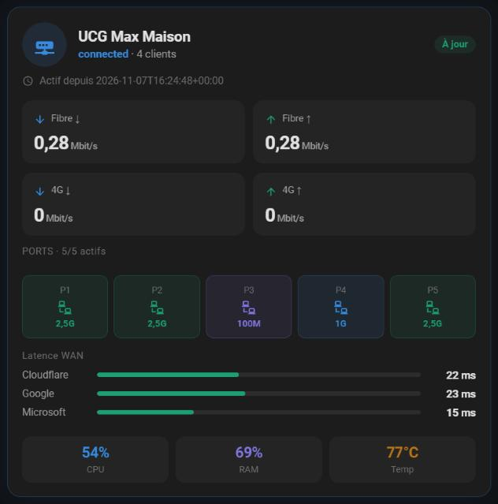
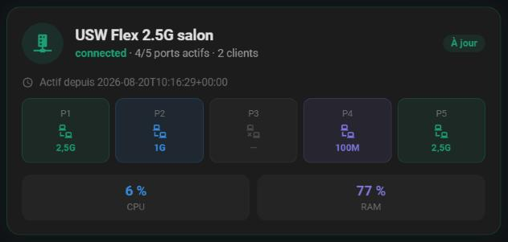
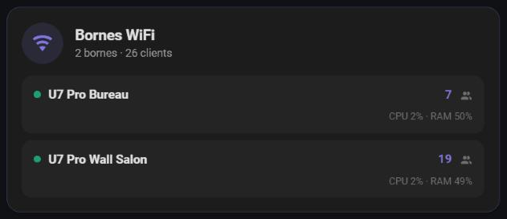
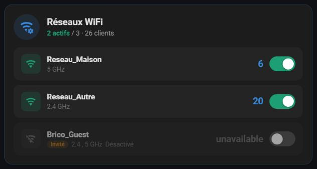
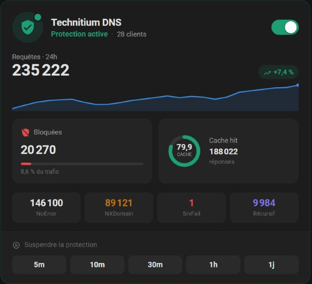
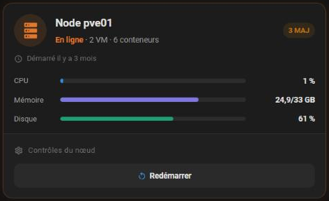
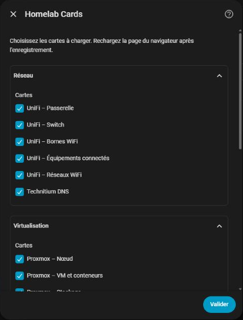

# Homelab Cards for Home Assistant

[English](README.md) · [Site](https://kenny3231.github.io/ha-homelab-cards/) · [](https://hacs.xyz)

Cartes Lovelace pour homelab Home Assistant : UniFi, Proxmox, Synology, Transmission, Technitium DNS, Android TV et plus. Zéro dépendance, éditeur visuel inclus, une seule installation HACS, vous choisissez les cartes.

<p align="center">     </p>

## Installation (HACS)

1. Dans HACS, ouvrez le menu (⋮) → **Dépôts personnalisés**.
2. Ajoutez `https://github.com/Kenny3231/ha-homelab-cards` avec le type **Intégration**.
3. Cherchez **Homelab Cards**, cliquez sur **Télécharger**, puis **redémarrez Home Assistant**.
4. Paramètres → Appareils et services → **Ajouter une intégration** → **Homelab Cards**, cochez les cartes voulues.
5. Rechargez le navigateur (Ctrl+Shift+R). Modifiez un tableau de bord → **Ajouter une carte** → cherchez le nom de la carte (ex. « UniFi Gateway »).

L'écran de configuration regroupe les cartes par catégorie (Réseau, Virtualisation, Stockage, Média, Maison) avec des noms lisibles. Tout est coché par défaut ; changez la sélection plus tard dans *Paramètres → Appareils et services → Homelab Cards → Configurer*, puis rechargez le navigateur.

<p align="center"></p>

**Aucune ressource à déclarer** : l'intégration charge les cartes toute seule, même avec des tableaux de bord en mode YAML. Modifiez la sélection plus tard dans les options de l'intégration.

Installation manuelle : copiez `custom_components/homelab_cards` dans `/config/custom_components/` puis redémarrez.

## Intégrations requises

| | |
|---|---|
| [UniFi Network](https://www.home-assistant.io/integrations/unifi/) | native |
| [Proxmox VE](https://github.com/dougiteixeira/proxmoxve) | intégration personnalisée HACS |
| [Synology DSM](https://www.home-assistant.io/integrations/synology_dsm/) | native |
| [Transmission](https://www.home-assistant.io/integrations/transmission/) | native |
| [Technitium DNS](https://github.com/Amateur-God/home-assistant-technitiumdns) | intégration personnalisée HACS |
| [Android TV Remote](https://www.home-assistant.io/integrations/androidtv_remote/) | native |
| [Intex Spa](https://github.com/mathieu-mp/homeassistant-intex-spa) | intégration personnalisée HACS |
| [Portainer](https://www.home-assistant.io/integrations/portainer/) | native |
| [Battery entities (any integration)](https://www.home-assistant.io/integrations/sensor/#device-class) | native |
| [Climate entities (Netatmo, HomeKit, Tado, Zigbee…)](https://www.home-assistant.io/integrations/climate/) | native |

Les intégrations « HACS » sont à installer au préalable ; les « natives » sont fournies avec Home Assistant.

## Cartes

### Réseau

| Card | Nécessite | |
|---|---|---|
| `custom:unifi-gateway-card` | [UniFi Network](https://www.home-assistant.io/integrations/unifi/) | Passerelle UniFi (UCG / UDM / USG) : état, clients, uptime, latences WAN, ports et mises à jour. |
| `custom:unifi-switch-card` | [UniFi Network](https://www.home-assistant.io/integrations/unifi/) | Switch UniFi : grille de ports avec vitesse de lien et état. |
| `custom:unifi-ap-card` | [UniFi Network](https://www.home-assistant.io/integrations/unifi/) | Bornes WiFi UniFi : plusieurs AP dans une seule carte. |
| `custom:unifi-clients-card` | [UniFi Network](https://www.home-assistant.io/integrations/unifi/) | Équipements connectés : liste manuelle ou découverte automatique filtrable par plage IP. ⚠️ Le filtre par plage IP exige que vos device_tracker exposent un attribut IP (réglable via auto.ip_attribute). |
| `custom:unifi-wifi-card` | [UniFi Network](https://www.home-assistant.io/integrations/unifi/) | Active / désactive chaque réseau WiFi (SSID) et affiche le nombre de clients. ⚠️ Les switches de réseau WiFi ne sont créés par l'intégration UniFi que si l'option correspondante est activée. |
| `custom:dns-status-card` | [Technitium DNS](https://github.com/Amateur-God/home-assistant-technitiumdns) | Statut DNS Technitium : requêtes, blocage de pubs (pause temporisée) et historique en sparkline. |

### Virtualisation

| Card | Nécessite | |
|---|---|---|
| `custom:proxmox-node-card` | [Proxmox VE](https://github.com/dougiteixeira/proxmoxve) | Nœud PVE : CPU, mémoire, disque, swap et actions (tout démarrer/arrêter, redémarrer, éteindre). |
| `custom:proxmox-guests-card` | [Proxmox VE](https://github.com/dougiteixeira/proxmoxve) | VM (QEMU) et conteneurs (LXC) avec boutons contextuels démarrer / éteindre / forcer / redémarrer. |
| `custom:proxmox-storage-card` | [Proxmox VE](https://github.com/dougiteixeira/proxmoxve) | Volumes de stockage Proxmox : occupation et état. |
| `custom:proxmox-disks-card` | [Proxmox VE](https://github.com/dougiteixeira/proxmoxve) | Disques physiques : santé S.M.A.R.T., température et usure SSD. ⚠️ L'usure SSD est ambiguë selon le firmware : réglez wearout_mode par disque (used = usure, remaining = vie restante). |

### Stockage

| Card | Nécessite | |
|---|---|---|
| `custom:synology-nas-card` | [Synology DSM](https://www.home-assistant.io/integrations/synology_dsm/) | Système DSM : CPU, mémoire, charge, débits, mise à jour et actions (redémarrer / éteindre). |
| `custom:synology-volumes-card` | [Synology DSM](https://www.home-assistant.io/integrations/synology_dsm/) | Volumes DSM : espace utilisé et état. |
| `custom:synology-drives-card` | [Synology DSM](https://www.home-assistant.io/integrations/synology_dsm/) | Disques DSM : état, température et alarmes S.M.A.R.T. (secteurs défectueux, durée de vie). |

### Média & téléchargements

| Card | Nécessite | |
|---|---|---|
| `custom:transmission-status-card` | [Transmission](https://www.home-assistant.io/integrations/transmission/) | Client Transmission : débits, torrents actifs, mode tortue, liste détaillée des torrents. ⚠️ Lit l'attribut torrent_info des capteurs *_torrents. power_entity est requis. |
| `custom:perso-remote-card` | [Android TV Remote](https://www.home-assistant.io/integrations/androidtv_remote/) | Télécommande « physique » : D-pad circulaire, touches en relief, volume via un media_player. |
| `custom:perso-apps-card` | [Android TV Remote](https://www.home-assistant.io/integrations/androidtv_remote/) | Grille de lancement d'applications pour une entité remote (Android TV / Shield). ⚠️ Les logos sont à déposer dans /config/www/apps/ (ex. netflix.webp) ; ils ne sont pas fournis. |

### Maison

| Card | Nécessite | |
|---|---|---|
| `custom:intex-spa-card` | [Intex Spa](https://github.com/mathieu-mp/homeassistant-intex-spa) | Spa Intex : température, chauffage, filtration, bulles, jets, animations bulles et vapeur. |
| `custom:battery-inventory-card` | [Battery entities (any integration)](https://www.home-assistant.io/integrations/sensor/#device-class) | Piles et batteries classées par type de pile (CR2032, AA, 2xAAA…) : niveaux, seuils d'alerte, tri et résumé « à racheter ». ⚠️ Fonctionne sans configuration : toutes les entités batterie détectées s'affichent, à ranger ensuite par type depuis l'éditeur. |
| `custom:thermostat-control-card` | [Climate entities (Netatmo, HomeKit, Tado, Zigbee…)](https://www.home-assistant.io/integrations/climate/) | Thermostat : jauge de température, consigne −/+, modes, presets, humidité, planning actif et historique intégré. ⚠️ Compatible avec toute entité climate ; une entité de repli peut prendre le relais quand l'entité principale est indisponible. |
| `custom:valve-control-card` | [Climate entities (Netatmo, HomeKit, Tado, Zigbee…)](https://www.home-assistant.io/integrations/climate/) | Vanne thermostatique : jauge de température, ouverture / demande de chauffe, consigne −/+, presets, batterie, vannes de la pièce et historique intégré. ⚠️ Compatible avec toute entité climate ; l'ouverture est lue dans un attribut (heating_power_request par défaut, réglable via power_attribute). |

### Conteneurs

| Card | Nécessite | |
|---|---|---|
| `custom:portainer-containers-card` | [Portainer](https://www.home-assistant.io/integrations/portainer/) | Conteneurs Docker : état, santé, CPU, mémoire, uptime, mises à jour d'image, recherche, filtres, tri, groupement par stack et actions (démarrer, arrêter, redémarrer, pause, kill, recréer). ⚠️ Découverte automatique de tous les conteneurs ; limitez par endpoint ou stack dans l'éditeur. Certains capteurs (CPU, mémoire) peuvent être désactivés par défaut dans l'intégration. |
| `custom:portainer-stacks-card` | [Portainer](https://www.home-assistant.io/integrations/portainer/) | Stacks Portainer : type, nombre de conteneurs, démarrer / arrêter, mise à jour (redéploiement) et résumé des conteneurs. |
| `custom:portainer-endpoint-card` | [Portainer](https://www.home-assistant.io/integrations/portainer/) | Endpoint Docker : version, OS, architecture, CPU / mémoire, compteurs de conteneurs, images, usage disque et purges (images, volumes, cache de build, réseaux). |

## Exemple

```yaml
type: custom:unifi-gateway-card
title: Gateway
```

Chaque carte possède un éditeur visuel : utilisez-le pour choisir vos entités.

## Contribuer

Issues et pull requests bienvenues. Les cartes sont dans `custom_components/homelab_cards/cards/<catégorie>/` (prises en compte automatiquement) ; `npm run check` puis `npm run docs` pour les README.

## Licence

MIT
